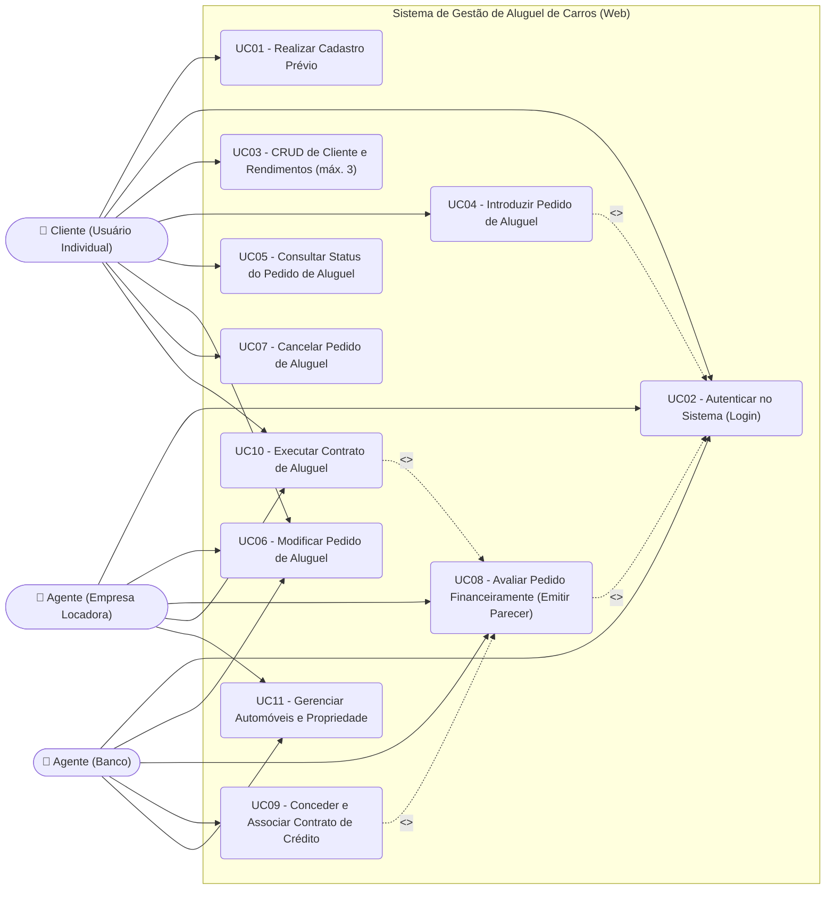
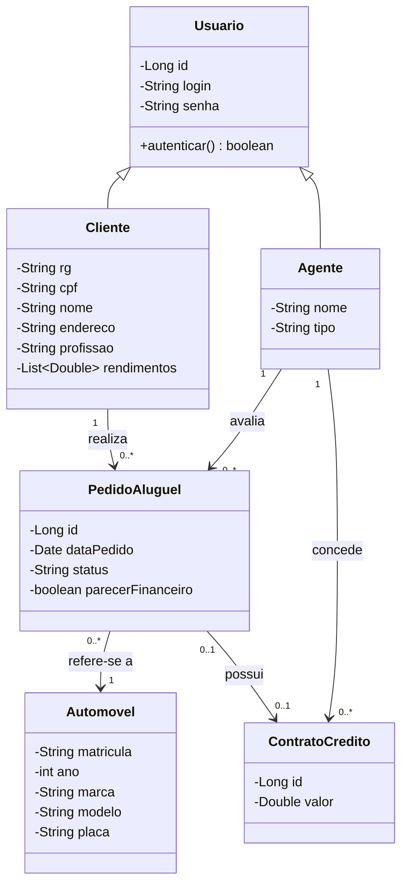
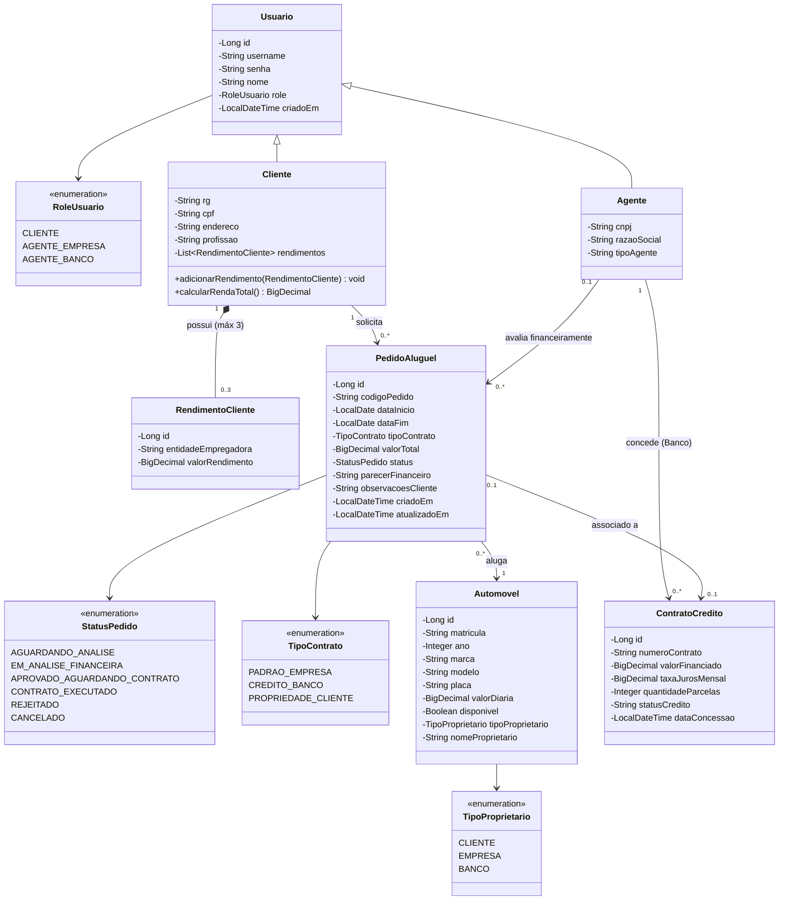
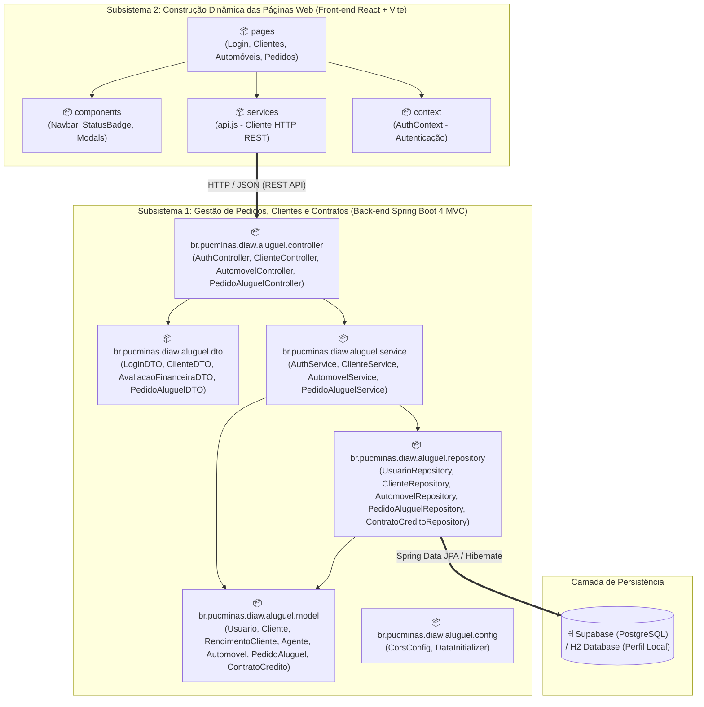

# 🚗 Sistema de Aluguel de Carros — LAB02 (DIAW)


> **Pontifícia Universidade Católica de Minas Gerais (PUC Minas)**
> - **Curso:** Engenharia de Software (2º Período)
> - **Disciplina:** Desenvolvimento e Integração de Aplicações Web (DIAW)
> - **Professor:** João Paulo Carneiro Aramuni
> - **Aluno:** Rafael Gomes Antunes de Oliveira
> - **Avaliação:** Laboratório 02 — Sistema de Aluguel de Carros (15 pontos)

---

## 📌 Sumário

1. [Sobre o Projeto](#-sobre-o-projeto)
2. [Stack Tecnológica](#-stack-tecnológica)
3. [Histórias de Usuário (User Stories)](#-histórias-de-usuário-user-stories)
4. [Modelagem do Sistema (UML)](#-modelagem-do-sistema-uml)
   - [Diagrama de Casos de Uso](#1-diagrama-de-casos-de-uso)
   - [Diagrama de Classes (Versão Inicial vs. Versão Final)](#2-diagrama-de-classes-evolução-do-modelo)
   - [Diagrama de Pacotes — Visão Lógica (Arquitetura MVC e Subsistemas)](#3-diagrama-de-pacotes--visão-lógica-arquitetura-mvc)
5. [Estrutura do Repositório](#-estrutura-do-repositório)
6. [Configuração do Banco de Dados (Supabase / Local)](#-configuração-do-banco-de-dados-supabase--local)
7. [Como Executar o Projeto](#-como-executar-o-projeto)
8. [Credenciais de Teste (Seed Inicial)](#-credenciais-de-teste-seed-inicial)
9. [Endpoints da API REST (MVC)](#-endpoints-da-api-rest-mvc)

---

## 📖 Sobre o Projeto

Sistema Web para apoio à **gestão de aluguéis de automóveis**, permitindo introduzir, consultar, modificar, avaliar financeiramente e cancelar pedidos através da Internet, além de gerenciar clientes, automóveis e contratos de crédito.

### Principais Regras de Negócio Atendidas:
1. **Autenticação Obrigatória:** O sistema só pode ser utilizado após cadastro prévio e autenticação (login com usuário e senha), diferenciando os perfis de **Cliente** (`CLIENTE`), **Agente Empresa** (`AGENTE_EMPRESA`) e **Agente Banco** (`AGENTE_BANCO`).
2. **Gestão de Clientes (CRUD Completo):** Armazena dados de identificação (**RG, CPF, Nome, Endereço**), **profissão** e até **3 entidades empregadoras com seus respectivos rendimentos auferidos** (máximo 3).
3. **Gestão de Automóveis e Propriedade:** Registra **matrícula, ano, marca, modelo e placa**. Dependendo do tipo de contrato, os automóveis podem ser registrados como propriedade de **clientes, empresas ou bancos**.
4. **Ciclo de Vida do Pedido de Aluguel e Análise Financeira:**
   - **Clientes** podem introduzir, modificar, consultar o status e cancelar seus pedidos de aluguel, bem como executar o contrato após parecer financeiro positivo.
   - **Agentes (Empresas e Bancos)** podem modificar pedidos e avaliá-los do ponto de vista financeiro (emitindo parecer positivo ou negativo com base nos rendimentos do cliente).
   - **Contratos de Crédito:** O aluguel de um automóvel pode estar associado a um **contrato de crédito** concedido por um dos bancos agentes.

---

## 🛠️ Stack Tecnológica

| Camada | Tecnologia | Versão / Detalhes |
| :--- | :--- | :--- |
| **Linguagem Back-end** | Java | JDK 25 |
| **Framework Back-end** | Spring Boot (Arquitetura MVC) | 4.0.x (Spring Web MVC, Spring Data JPA, Validation) |
| **Build & Dependências** | Apache Maven | Maven Wrapper (`mvnw` / `pom.xml`) |
| **Front-end** | React + Vite | React + Vite (SPA Dinâmica) |
| **Banco de Dados** | Supabase (PostgreSQL) | PostgreSQL em Nuvem (+ H2 para execução imediata local) |
| **Autenticação** | Sessão / Token (Login Obrigatório) | Usuário, senha e controle de acesso baseado em perfil (Role) |

---

## 📝 Histórias de Usuário (User Stories)

| ID | Ator | História de Usuário | Critérios de Aceitação | Prioridade |
| :-: | :--- | :--- | :--- | :-: |
| **US01** | Usuário (Cliente / Agente) | **Como** usuário do sistema, **quero** realizar meu cadastro prévio e fazer login com usuário e senha **para** ter acesso autenticado às funcionalidades do sistema. | - Bloquear acesso às telas internas sem login;<br>- Validar credenciais e retornar perfil (`CLIENTE`, `AGENTE_EMPRESA`, `AGENTE_BANCO`). | Alta |
| **US02** | Cliente / Administrador | **Como** cliente, **quero** cadastrar, visualizar, editar e excluir meus dados pessoais (RG, CPF, Nome, Endereço, Profissão) e meus rendimentos **para** manter meu cadastro atualizado para análise financeira. | - CRUD completo de Cliente;<br>- Permitir adicionar de 1 até no **máximo 3** entidades empregadoras com seus respectivos rendimentos auferidos;<br>- Impedir mais de 3 rendimentos. | Alta |
| **US03** | Cliente | **Como** cliente autenticado, **quero** introduzir um novo pedido de aluguel escolhendo um automóvel disponível, período e modalidade de contrato **para** alugar um veículo pela Internet. | - Calcular automaticamente o valor total com base nas diárias;<br>- Criar pedido com status inicial `AGUARDANDO_ANALISE`. | Alta |
| **US04** | Cliente | **Como** cliente autenticado, **quero** consultar o status detalhado, modificar as datas/observações ou cancelar meu pedido de aluguel **para** gerenciar minhas solicitações. | - Exibir status atualizado e parecer financeiro;<br>- Permitir modificação ou cancelamento enquanto o contrato não estiver finalizado. | Alta |
| **US05** | Agente (Empresa / Banco) | **Como** agente autenticado, **quero** visualizar os dados financeiros do cliente (rendimentos e empregadores) e avaliar os pedidos de aluguel **para** emitir um parecer financeiro positivo ou negativo. | - Exibir renda total e empregadores do cliente;<br>- Em caso de parecer positivo, disponibilizar o pedido (`APROVADO_AGUARDANDO_CONTRATO`) para execução do contrato. | Alta |
| **US06** | Agente (Banco) | **Como** banco agente, **quero** associar um contrato de crédito (valor financiado, taxa de juros e parcelas) a um pedido de aluguel aprovado **para** viabilizar o financiamento do veículo. | - Gerar número de contrato de crédito vinculado ao banco agente;<br>- Associar o contrato de crédito ao pedido de aluguel. | Média |
| **US07** | Cliente / Agente | **Como** parte contratante, **quero** executar o contrato de um pedido aprovado financeiramente **para** formalizar a locação e atualizar o registro de propriedade do automóvel conforme o tipo de contrato. | - Alterar status para `CONTRATO_EXECUTADO`;<br>- Atualizar propriedade do automóvel (`CLIENTE`, `EMPRESA` ou `BANCO`) conforme o tipo de contrato. | Média |
| **US08** | Agente (Empresa / Banco) | **Como** agente, **quero** cadastrar e gerenciar automóveis (matrícula, ano, marca, modelo, placa e proprietário) **para** manter a frota atualizada no sistema. | - Validar unicidade de matrícula e placa;<br>- Registrar tipo de proprietário (`CLIENTE`, `EMPRESA`, `BANCO`). | Média |

---

## 📐 Modelagem do Sistema (UML)

Todos os arquivos fontes dos diagramas encontram-se versionados no diretório [`docs/uml/`](docs/uml/).

### 1. Diagrama de Casos de Uso

Representa as interações dos atores (**Cliente**, **Agente Empresa** e **Agente Banco**) com o sistema após autenticação obrigatória:



---

### 2. Diagrama de Classes (Evolução do Modelo)

Conforme solicitado nas instruções da **Apresentação Final**, apresentamos abaixo o **Modelo Inicial (v1)** concebido na análise preliminar e o **Modelo Final Revisado (v2)** alinhado 100% ao código implementado em Java (Spring Boot MVC).

#### 🔹 Versão 1 — Modelo Conceitual Inicial ([`diagrama_de_classes_v1_inicial.mmd`](docs/uml/diagrama_de_classes_v1_inicial.mmd))



#### 🔹 Versão 2 — Modelo de Classes Final Implementado ([`diagrama_de_classes_v2_final.mmd`](docs/uml/diagrama_de_classes_v2_final.mmd))



#### 📊 Comparativo de Evolução (Modelo Inicial vs. Modelo Final Implementado)

| Aspecto | Modelo Inicial (v1) | Modelo Final Revisado (v2) | Justificativa Técnica / Alinhamento com Requisitos |
| :--- | :--- | :--- | :--- |
| **Rendimentos e Empregadores** | Lista simples `List<Double>` na classe `Cliente`. | Entidade dedicada `RendimentoCliente` (`entidadeEmpregadora`, `valorRendimento`) com composição `0..3`. | O requisito exige armazenar **tanto as entidades empregadoras quanto os respectivos rendimentos auferidos (máximo 3)**. |
| **Propriedade do Automóvel** | Não possuía atributo de titularidade explícito. | Adicionado `TipoProprietario` (`CLIENTE`, `EMPRESA`, `BANCO`) e `nomeProprietario` em `Automovel`. | Atende à regra: *"Dependendo do tipo de contrato, os automóveis alugados podem ser registrados como propriedade dos clientes, empresas ou bancos"*. |
| **Fluxo de Status do Pedido** | Atributo texto livre `status` e `boolean parecerFinanceiro`. | Enumeração `StatusPedido` com máquina de estados completa e justificativa textual em `parecerFinanceiro`. | Permite rastrear desde a introdução (`AGUARDANDO_ANALISE`), aprovação financeira (`APROVADO_AGUARDANDO_CONTRATO`) até a `CONTRATO_EXECUTADO` ou `CANCELADO`. |
| **Contrato de Crédito** | Apenas `id` e `valor`. | Classe completa `ContratoCredito` vinculada ao `Agente` (Banco), contendo `numeroContrato`, `taxaJurosMensal` e `quantidadeParcelas`. | Atende à associação de aluguéis com contratos de crédito concedidos por bancos agentes. |

---

### 3. Diagrama de Pacotes — Visão Lógica (Arquitetura MVC)

Atendendo à especificação de que *"o sistema pode ser subdividido em dois subsistemas: um para gestão de pedidos e contratos; e outro para a construção dinâmica das páginas web"*, o diagrama de pacotes abaixo ilustra a arquitetura MVC e a integração entre os subsistemas:



---

## 📂 Estrutura do Repositório

```text
LAB2/
├── README.md                                  # Documentação completa (Template PUC Minas)
├── DIAW_-_LABORATÓRIO_02_...pdf               # Especificação oficial do trabalho
├── docs/
│   ├── sql/
│   │   └── supabase_schema.sql                # Script DDL PostgreSQL para o Supabase
│   └── uml/
│       ├── casos_de_uso.mmd                   # Diagrama de Casos de Uso
│       ├── diagrama_de_classes_v1_inicial.mmd # Modelo de Classes Inicial (v1)
│       ├── diagrama_de_classes_v2_final.mmd   # Modelo de Classes Final Revisado (v2)
│       └── diagrama_de_pacotes_mvc.mmd        # Diagrama de Pacotes (Visão Lógica MVC)
├── backend/                                   # Subsistema 1: Spring Boot 4.0.x + Java 25 (MVC)
│   ├── pom.xml
│   └── src/main/
│       ├── java/br/pucminas/diaw/aluguel/
│       │   ├── config/                        # CORS e Carga Inicial de Dados (Seed)
│       │   ├── controller/                    # Camada Controller (REST MVC)
│       │   ├── dto/                           # Objetos de Transferência de Dados
│       │   ├── exception/                     # Tratamento Global de Erros e Regras
│       │   ├── model/                         # Camada Model (Entidades JPA e Enums)
│       │   ├── repository/                    # Camada Repository (Spring Data JPA)
│       │   └── service/                       # Camada Service (Regras de Negócio)
│       └── resources/
│           ├── application.properties         # Configuração padrão (H2 + variáveis Supabase)
│           └── application-supabase.properties# Perfil dedicado para conexão Supabase PostgreSQL
└── frontend/                                  # Subsistema 2: React + Vite (Páginas Web Dinâmicas)
    ├── package.json
    ├── vite.config.js
    └── src/
        ├── context/AuthContext.jsx            # Controle de autenticação obrigatório
        ├── services/api.js                    # Integração REST com o Spring Boot
        ├── components/                        # Barra de navegação, indicadores de status
        └── pages/                             # Telas: Login/Cadastro, CRUD Clientes, Frota e Pedidos
```

---

## 🗄️ Configuração do Banco de Dados (Supabase / Local)

O back-end está preparado para rodar **imediatamente** em modo de desenvolvimento local (com banco em memória H2 pré-populado automaticamente pelo `DataInitializer`) ou conectado ao **Supabase (PostgreSQL)** em nuvem.

### Como conectar ao seu projeto Supabase:
1. Crie um projeto gratuito em [https://supabase.com](https://supabase.com).
2. No painel do Supabase, acesse **SQL Editor** e execute o script [`docs/sql/supabase_schema.sql`](docs/sql/supabase_schema.sql) (ou deixe o Hibernate criar automaticamente via `ddl-auto=update`).
3. Vá em **Project Settings > Database > Connection String (JDBC)** e defina as variáveis de ambiente ou edite [`backend/src/main/resources/application-supabase.properties`](backend/src/main/resources/application-supabase.properties):
   ```properties
   SUPABASE_DB_URL=jdbc:postgresql://aws-0-sa-east-1.pooler.supabase.com:6543/postgres?prepareThreshold=0
   SUPABASE_DB_USER=postgres.seu_projeto_id
   SUPABASE_DB_PASSWORD=sua_senha_do_supabase
   ```
4. Inicie o Spring Boot com o perfil `supabase`:
   ```bash
   ./mvnw spring-boot:run -Dspring-boot.run.profiles=supabase
   ```

---

## 🚀 Como Executar o Projeto

### 1. Executando o Back-end (Spring Boot 4 + JDK 25)
No terminal, entre na pasta `backend`:
```bash
cd backend
./mvnw spring-boot:run
```
> O servidor iniciará em `http://localhost:8080`. Na inicialização, o componente `DataInitializer` cria automaticamente usuários de teste (Clientes, Empresa Locadora e Banco Agente), automóveis e pedidos de exemplo.

### 2. Executando o Front-end (React + Vite)
Em outro terminal, entre na pasta `frontend`:
```bash
cd frontend
npm install
npm run dev
```
> A aplicação web estará disponível em `http://localhost:5173`.

---

## 🔑 Credenciais de Teste (Seed Inicial)

Você pode criar novos clientes ou agentes diretamente na tela de **Cadastro Prévio**, ou utilizar as contas pré-cadastradas abaixo com um clique na tela de Login:

| Perfil | Usuário (`username`) | Senha | Papel no Sistema |
| :--- | :---: | :---: | :--- |
| 👤 **Cliente Individual** | `cliente` | `123456` | Introduz, consulta, modifica, cancela pedidos e executa contratos aprovados. |
| 🏢 **Agente (Empresa)** | `empresa` | `123456` | Avalia pedidos financeiramente, modifica pedidos e gerencia frota de veículos. |
| 🏦 **Agente (Banco)** | `banco` | `123456` | Avalia pedidos financeiramente, **concede contratos de crédito** e gerencia veículos. |

---

## 🌐 Endpoints da API REST (MVC)

| Método | Endpoint | Descrição | Perfis Permitidos |
| :---: | :--- | :--- | :--- |
| `POST` | `/api/auth/login` | Autentica usuário (cliente ou agente) com login e senha | Público |
| `POST` | `/api/auth/registro-agente` | Cadastra novo Agente (Empresa ou Banco) | Público |
| `GET` | `/api/clientes` | Lista todos os clientes com seus rendimentos (máx. 3) | Autenticado |
| `GET` | `/api/clientes/{id}` | Busca dados detalhados de um cliente por ID | Autenticado |
| `POST` | `/api/clientes` | Cria um novo Cliente (CRUD) com até 3 empregadores/rendimentos | Público / Autenticado |
| `PUT` | `/api/clientes/{id}` | Atualiza dados de identificação, profissão e rendimentos do Cliente | Cliente / Agente |
| `DELETE` | `/api/clientes/{id}` | Remove o cadastro de um Cliente | Cliente / Agente |
| `GET` | `/api/automoveis` | Lista a frota de automóveis e seus proprietários atuais | Autenticado |
| `POST` | `/api/automoveis` | Cadastra novo automóvel (matrícula, ano, marca, modelo, placa) | Agente |
| `GET` | `/api/pedidos` | Lista pedidos de aluguel (filtrável por `clienteId`) | Autenticado |
| `POST` | `/api/pedidos` | Introduz um novo pedido de aluguel | Cliente |
| `PUT` | `/api/pedidos/{id}` | Modifica um pedido de aluguel existente | Cliente / Agente |
| `PATCH` | `/api/pedidos/{id}/avaliar` | Avalia financeiramente o pedido e opcionalmente associa Contrato de Crédito | Agente (Empresa/Banco) |
| `PATCH` | `/api/pedidos/{id}/executar-contrato` | Executa o contrato após parecer financeiro positivo | Cliente / Agente |
| `PATCH` | `/api/pedidos/{id}/cancelar` | Cancela um pedido de aluguel | Cliente / Agente |

