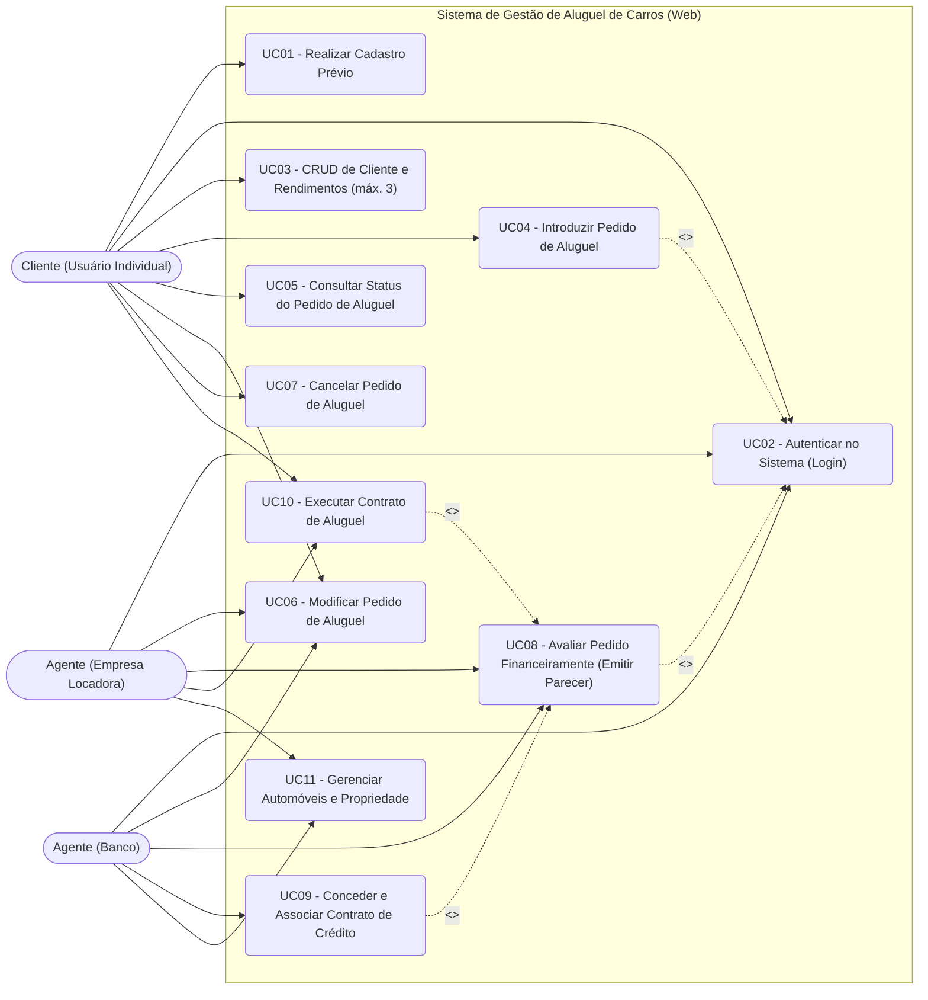
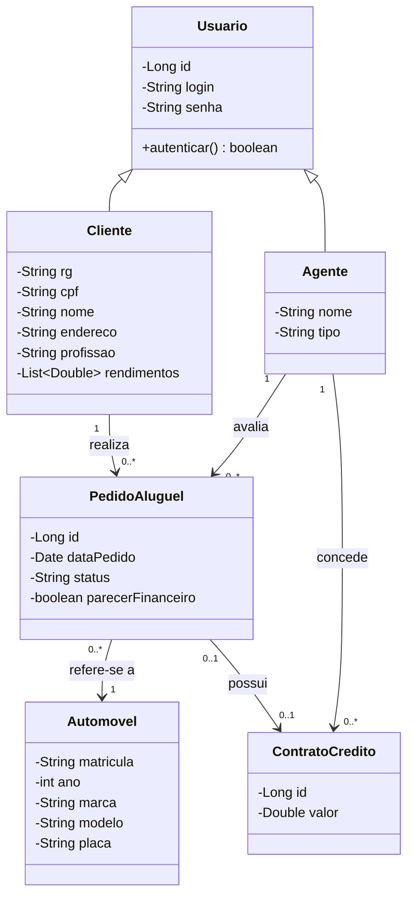
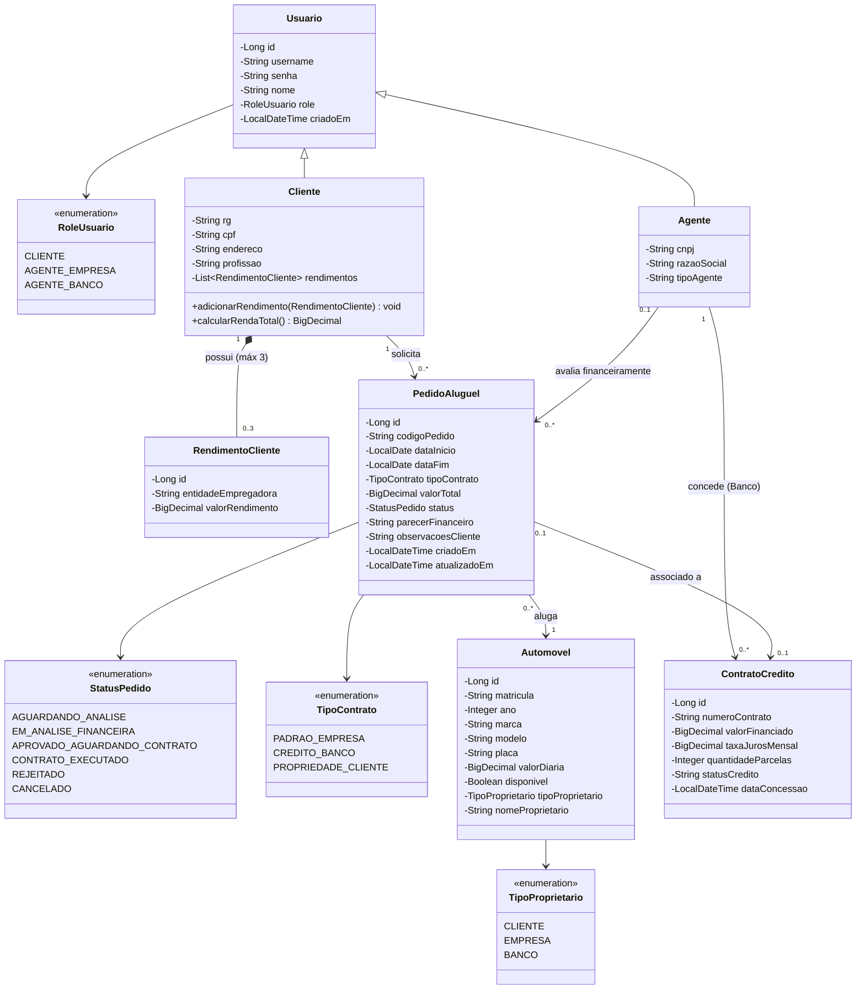
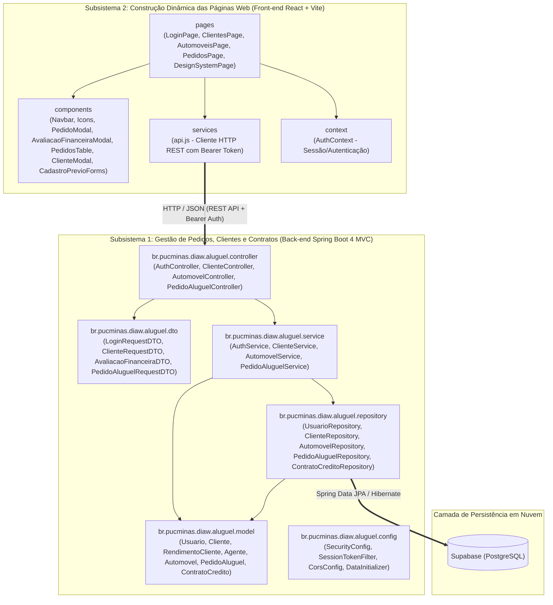
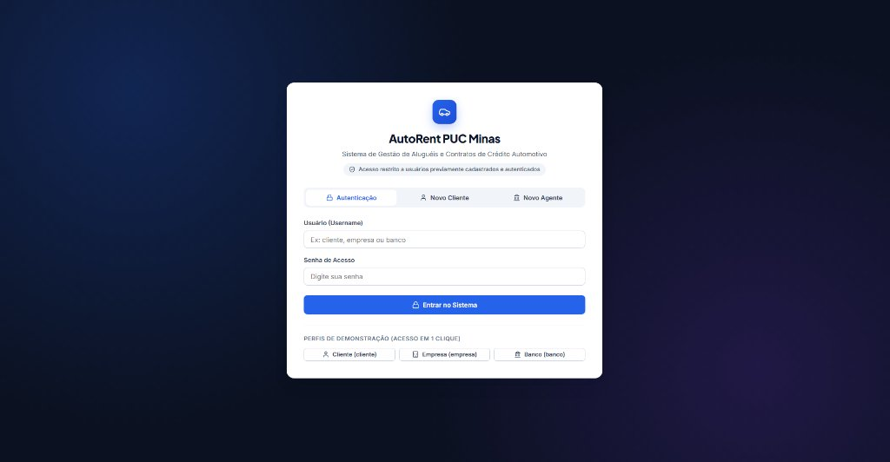
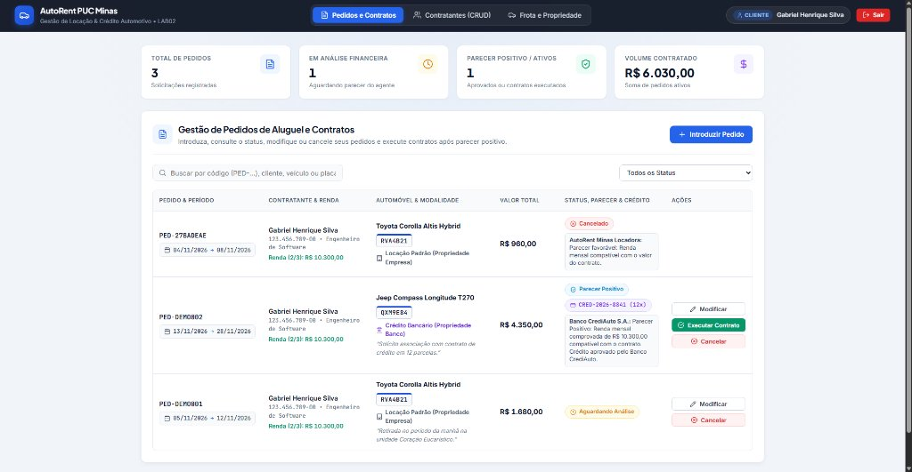
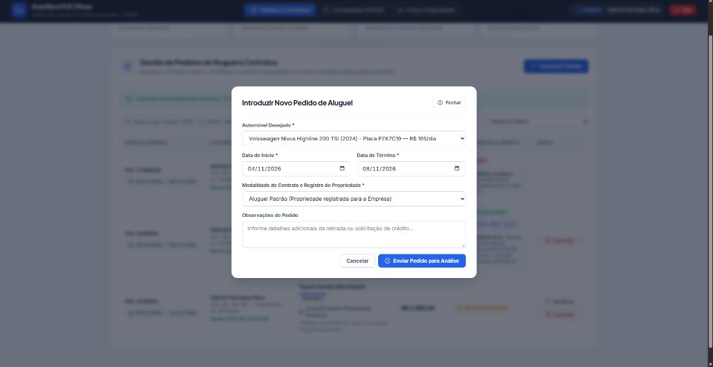
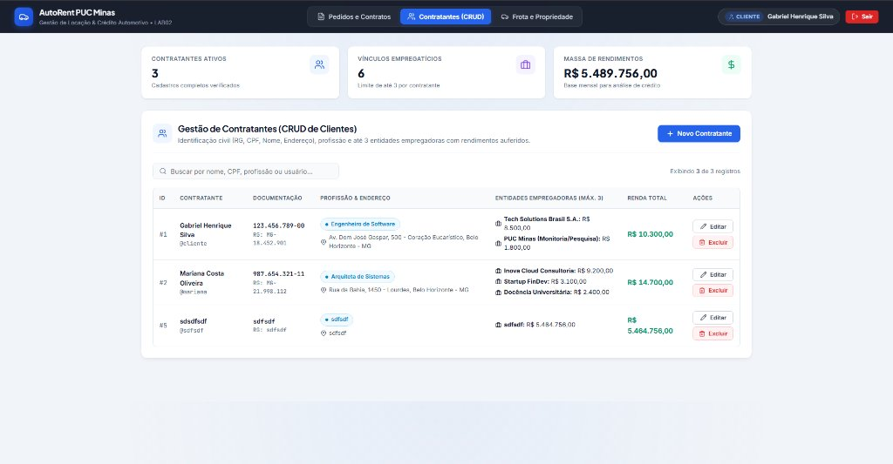
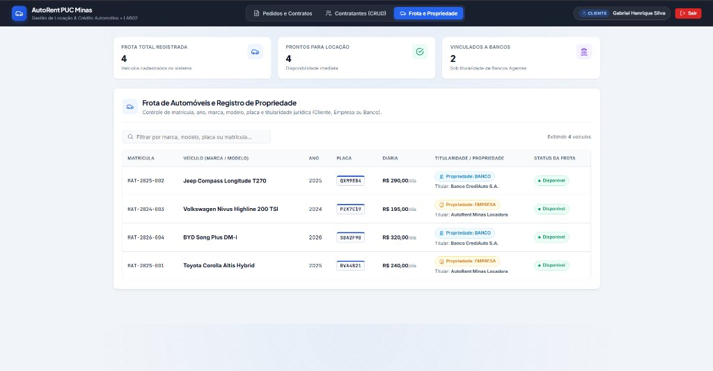

<div align="center">
  

  # Sistema de Aluguel de Carros (AutoRent PUC Minas)

  **Pontifícia Universidade Católica de Minas Gerais (PUC Minas)**  
  **Curso:** Engenharia de Software (2º Período) • **Disciplina:** Desenvolvimento e Integração de Aplicações Web (DIAW)

  
  
  
  
  
  
</div>

---

## Alunos integrantes da equipe

* **Rafael Gomes Antunes de Oliveira**

## Professores responsáveis

* **João Paulo Carneiro Aramuni**

---

## Links Úteis

* **Repositório no GitHub:** [https://github.com/rafaelgantunes/Crud-Aluguel-de-Carros](https://github.com/rafaelgantunes/Crud-Aluguel-de-Carros)
* **Script SQL (Supabase / PostgreSQL):** [`docs/sql/supabase_schema.sql`](docs/sql/supabase_schema.sql)
* **Modelos UML Versionados:** [`docs/uml/`](docs/uml/)
* **Design System (UI/UX Pro Max):** [`design-system/MASTER.md`](design-system/MASTER.md)

---

## Sumário

1. [Sobre o Projeto](#sobre-o-projeto)
2. [Funcionalidades Principais](#funcionalidades-principais)
3. [Tecnologias Utilizadas](#tecnologias-utilizadas)
4. [Histórias de Usuários](#histórias-de-usuários)
5. [Arquitetura e Modelagem do Sistema (UML)](#arquitetura-e-modelagem-do-sistema-uml)
   - [Diagrama de Casos de Uso](#1-diagrama-de-casos-de-uso)
   - [Diagrama de Classes (Evolução: Modelo Inicial vs. Modelo Final)](#2-diagrama-de-classes-evolução-do-modelo)
   - [Diagrama de Pacotes — Visão Lógica (Arquitetura MVC)](#3-diagrama-de-pacotes--visão-lógica-arquitetura-mvc)
6. [Estrutura de Pastas](#estrutura-de-pastas)
7. [Demonstração (Protótipo e Telas do Sistema)](#demonstração-protótipo-e-telas-do-sistema)
8. [Instruções de utilização (Instalação e Execução)](#instruções-de-utilização-instalação-e-execução)
9. [Testes](#testes)
10. [Deploy](#deploy)
11. [Endpoints da API REST (MVC)](#endpoints-da-api-rest-mvc)
12. [Histórico de versões](#histórico-de-versões)
13. [Licença](#licença)

---

## Sobre o Projeto

Sistema Web desenvolvido na disciplina de **Desenvolvimento e Integração de Aplicações Web (DIAW)** do curso de **Engenharia de Software da PUC Minas (Laboratório 02)**. O objetivo do projeto é apoiar a gestão de aluguéis de automóveis através da Internet, permitindo efetuar, consultar, modificar, avaliar financeiramente e cancelar pedidos de locação, gerenciar contratantes (clientes e seus rendimentos), controlar a titularidade da frota e associar contratos de crédito bancário.

---

## Funcionalidades Principais

1. **Autenticação Obrigatória e Segurança (`Spring Security` + `BCrypt`):**
   - O sistema só pode ser utilizado após cadastro prévio e autenticação (login com usuário e senha criptografada com `BCryptPasswordEncoder`);
   - Filtro de segurança (`SessionTokenFilter` + `SecurityConfig`) protegendo as rotas da API REST (`/api/**`) via token `Bearer`, distinguindo os perfis de **Cliente** (`CLIENTE`), **Agente Empresa** (`AGENTE_EMPRESA`) e **Agente Banco** (`AGENTE_BANCO`).
2. **Gestão de Contratantes (CRUD Completo de Cliente):**
   - Armazena os dados de identificação civil (**RG, CPF, Nome, Endereço**), **profissão**, as **entidades empregadoras** e os respectivos **rendimentos auferidos (máximo 3)**;
   - Limite máximo de 3 rendimentos validado tanto no Front-end quanto em 3 camadas do Back-end (`@Size(max = 3)` em `ClienteRequestDTO`, validação em `ClienteService` e regra de domínio em `Cliente.adicionarRendimento`).
3. **Gestão de Automóveis e Propriedade:**
   - Registra **matrícula, ano, marca, modelo e placa**. Dependendo do tipo de contrato, os automóveis alugados podem ser registrados como propriedade de **clientes, empresas ou bancos**.
4. **Ciclo de Vida do Pedido de Aluguel e Análise Financeira:**
   - **Clientes** podem introduzir, modificar, consultar o status e cancelar pedidos de aluguel, além de formalizar a execução do contrato após parecer positivo;
   - **Agentes (Empresas e Bancos)** podem modificar e avaliar pedidos sob o ponto de vista financeiro e, em caso de parecer positivo, colocá-los à consideração para execução do contrato;
   - **Contrato de Crédito:** O aluguel de um automóvel pode estar associado a um contrato de crédito concedido por um dos bancos agentes.

---

## Tecnologias Utilizadas

* **Linguagem:** Java — JDK 25
* **Back-end:** Spring Boot 4.0.5 (Arquitetura MVC, Spring Security com `BCryptPasswordEncoder`, Spring Web, Spring Data JPA, Jakarta Bean Validation)
* **Build e Dependências:** Apache Maven (`mvnw` / `pom.xml`)
* **Front-end:** React 19 + Vite 6 (Arquitetura componentizada e Design System responsivo *UI/UX Pro Max*)
* **Banco de Dados:** Supabase (PostgreSQL em nuvem) com fallback local H2 para testes automatizados

---

## Histórias de Usuários

| ID | Ator | História de Usuário | Critérios de Aceitação | Prioridade |
| :-: | :--- | :--- | :--- | :-: |
| **US01** | Usuário (Cliente / Agente) | **Como** usuário do sistema, **quero** realizar meu cadastro prévio e fazer login com usuário e senha **para** ter acesso autenticado às funcionalidades do sistema. | - Criptografar senhas com `BCrypt` e proteger endpoints via `Spring Security`;<br>- Validar credenciais e carregar perfil (`CLIENTE`, `AGENTE_EMPRESA`, `AGENTE_BANCO`). | Alta |
| **US02** | Cliente / Agente | **Como** cliente, **quero** cadastrar, visualizar, atualizar e remover meus dados pessoais (RG, CPF, Nome, Endereço, Profissão) e meus rendimentos **para** manter meu cadastro apto à análise financeira. | - CRUD completo de Cliente;<br>- Validar no Front-end e no Back-end até no **máximo 3** entidades empregadoras e respectivos rendimentos auferidos. | Alta |
| **US03** | Cliente | **Como** cliente autenticado, **quero** introduzir um novo pedido de aluguel selecionando um automóvel, período e modalidade de contrato **para** solicitar a locação pela Internet. | - Calcular automaticamente o valor total conforme as diárias;<br>- Registrar o pedido com status inicial `AGUARDANDO_ANALISE`. | Alta |
| **US04** | Cliente | **Como** cliente autenticado, **quero** consultar o status, modificar os dados ou cancelar meu pedido de aluguel **para** gerenciar minhas solicitações. | - Exibir status atualizado, datas e parecer financeiro;<br>- Permitir modificação ou cancelamento antes da execução final. | Alta |
| **US05** | Agente (Empresa / Banco) | **Como** agente autenticado, **quero** analisar o dossiê financeiro do contratante (rendimentos e empregadores) e avaliar os pedidos de aluguel **para** emitir um parecer financeiro positivo ou negativo. | - Exibir soma de rendimentos e vínculos empregatícios;<br>- Em caso de parecer positivo, alterar status para `APROVADO_AGUARDANDO_CONTRATO`. | Alta |
| **US06** | Agente (Banco) | **Como** banco agente, **quero** conceder e associar um contrato de crédito (valor financiado, taxa de juros e parcelas) a um pedido aprovado **para** financiar a locação. | - Gerar número único de contrato (`CRED-...`) vinculado ao banco agente;<br>- Associar o contrato de crédito ao pedido de aluguel. | Média |
| **US07** | Cliente / Agente | **Como** contratante, **quero** executar o contrato de um pedido aprovado financeiramente **para** formalizar a locação e atualizar o registro de propriedade do veículo. | - Alterar status do pedido para `CONTRATO_EXECUTADO`;<br>- Atualizar a titularidade do automóvel (`CLIENTE`, `EMPRESA` ou `BANCO`) conforme a modalidade contratada. | Média |
| **US08** | Agente (Empresa / Banco) | **Como** agente, **quero** cadastrar e consultar a frota de automóveis (matrícula, ano, marca, modelo, placa e proprietário) **para** manter os veículos disponíveis no sistema. | - Validar unicidade de matrícula e placa;<br>- Indicar titularidade e disponibilidade do automóvel. | Média |

---

## Arquitetura e Modelagem do Sistema (UML)

Os arquivos-fonte dos modelos UML estão versionados em [`docs/uml/`](docs/uml/).

### 1. Diagrama de Casos de Uso

Fonte: [`docs/uml/casos_de_uso.mmd`](docs/uml/casos_de_uso.mmd)



---

### 2. Diagrama de Classes (Evolução do Modelo)

Atendendo aos critérios de avaliação da **Apresentação Final**, apresentamos a comparação entre o **Modelo Inicial (v1)** e o **Modelo Final Revisado (v2)** alinhado ao código-fonte.

#### Versão 1 — Modelo Conceitual Inicial ([`diagrama_de_classes_v1_inicial.mmd`](docs/uml/diagrama_de_classes_v1_inicial.mmd))



#### Versão 2 — Modelo de Classes Final Implementado ([`diagrama_de_classes_v2_final.mmd`](docs/uml/diagrama_de_classes_v2_final.mmd))



#### Quadro Comparativo de Modificações (Modelo Inicial vs. Modelo Final)

| Aspecto | Modelo Inicial (v1) | Modelo Final Revisado (v2) | Justificativa de Projeto |
| :--- | :--- | :--- | :--- |
| **Empregadores e Rendimentos** | `List<Double>` simples em `Cliente`. | Entidade `RendimentoCliente` (`entidadeEmpregadora`, `valorRendimento`) com cardinalidade `0..3`. | Atende à regra de armazenar tanto o nome das entidades empregadoras quanto os respectivos rendimentos (máximo 3). |
| **Titularidade do Automóvel** | Sem atributo de propriedade. | Adicionado `TipoProprietario` (`CLIENTE`, `EMPRESA`, `BANCO`) e `nomeProprietario` em `Automovel`. | Permite atualizar o registro de propriedade do veículo conforme o tipo de contrato executado. |
| **Ciclo do Pedido** | Atributo `String status` e `boolean parecerFinanceiro`. | Enum `StatusPedido` e campo detalhado `parecerFinanceiro`. | Controla todas as etapas desde a introdução até a aprovação financeira, execução do contrato ou cancelamento. |
| **Contrato de Crédito** | Apenas `id` e `valor`. | Entidade completa com `numeroContrato`, `bancoAgente`, `taxaJurosMensal` e `quantidadeParcelas`. | Vincula o financiamento diretamente ao banco agente concessor. |

---

### 3. Diagrama de Pacotes — Visão Lógica (Arquitetura MVC)

Fonte: [`docs/uml/diagrama_de_pacotes_mvc.mmd`](docs/uml/diagrama_de_pacotes_mvc.mmd)



---

## Estrutura de Pastas

```text
Crud-Aluguel-de-Carros/
├── backend/                                      # Subsistema 1: Back-end Spring Boot 4.0.5 (JDK 25 / MVC)
│   ├── src/main/java/br/pucminas/diaw/aluguel/
│   │   ├── config/                               # SecurityConfig, SessionTokenFilter, CorsConfig, DataInitializer
│   │   ├── controller/                           # Controllers REST MVC (Auth, Cliente, Automovel, PedidoAluguel)
│   │   ├── dto/                                  # Records DTO com Bean Validation (@Valid, @Size(max=3))
│   │   ├── exception/                            # Tratamento global de exceções HTTP (GlobalExceptionHandler)
│   │   ├── model/                                # Entidades JPA (Usuario, Cliente, RendimentoCliente, Agente, Automovel, PedidoAluguel, ContratoCredito)
│   │   ├── repository/                           # Repositórios Spring Data JPA
│   │   └── service/                              # Regras de negócio, criptografia BCrypt e análise financeira
│   ├── src/main/resources/                       # application.properties (Supabase via variáveis de ambiente / fallback H2)
│   ├── src/test/java/                            # Testes automatizados de integração (JUnit 5 / SpringBootTest)
│   └── pom.xml                                   # Configuração Maven com JDK 25 e Spring Security
├── frontend/                                     # Subsistema 2: Front-end React 19 + Vite 6
│   ├── src/
│   │   ├── components/                           # Componentes modulares (Navbar, Icons, PedidoModal, AvaliacaoFinanceiraModal, PedidosTable, ClienteModal, CadastroPrevioForms)
│   │   ├── context/                              # Contexto global de autenticação (AuthContext)
│   │   ├── pages/                                # Páginas da aplicação (LoginPage, PedidosPage, ClientesPage, AutomoveisPage, DesignSystemPage)
│   │   └── services/                             # Cliente HTTP REST com cabeçalho Authorization Bearer (api.js)
│   └── package.json                              # Dependências e scripts Vite
├── docs/                                         # Artefatos de documentação do projeto
│   ├── img/                                      # Logotipo e capturas de tela do protótipo
│   ├── sql/                                      # Script DDL PostgreSQL para o Supabase (supabase_schema.sql)
│   └── uml/                                      # Diagramas UML em Mermaid (.mmd) - v1 inicial e v2 final
└── README.md                                     # Documentação principal conforme template da disciplina
```

---

## Demonstração (Protótipo e Telas do Sistema)

Abaixo estão as capturas de tela do protótipo funcional desenvolvido com **React + Vite** integrado ao **Spring Boot 4** e **Supabase**:

### 1. Tela de Autenticação Obrigatória e Cadastro Prévio
Restringe o acesso apenas a usuários autenticados, oferecendo abas para **Autenticação**, **Novo Cliente** (com até 3 vínculos empregatícios) e **Novo Agente** (Empresa ou Banco), além de acesso rápido de demonstração.



---

### 2. Painel de Gestão de Pedidos de Aluguel e Execução de Contratos
Apresenta indicadores executivos (KPIs), busca instantânea, filtro por status, acompanhamento de pareceres financeiros, contratos de crédito vinculados (`CRED-...`) e ações para **Modificar**, **Avaliar Finanças**, **Executar Contrato** e **Cancelar**.



---

### 3. Modal de Introdução de Novo Pedido de Aluguel
Permite ao contratante escolher o automóvel desejado, definir o período de locação, selecionar a modalidade de contrato/registro de propriedade (`Empresa`, `Banco` ou `Cliente`) e enviar para análise financeira.



---

### 4. Gestão de Contratantes (CRUD Completo de Clientes)
Gerencia os dados civis do contratante (**RG, CPF, Nome, Endereço e Profissão**) e suas **entidades empregadoras com os respectivos rendimentos auferidos (máximo 3)**, calculando automaticamente a renda total para análise de crédito.



---

### 5. Frota de Automóveis e Registro de Propriedade
Lista todos os veículos cadastrados (**matrícula, marca, modelo, ano, placa Mercosul e valor da diária**), destacando a titularidade jurídica atual (`Propriedade: EMPRESA`, `Propriedade: BANCO` ou `Propriedade: CLIENTE`) e o status de disponibilidade.



---

## Instruções de utilização (Instalação e Execução)

### Pré-requisitos
* **Java JDK 25** instalado
* **Node.js 20+** e **npm** instalados
* Banco de dados **Supabase (PostgreSQL)** configurado via variáveis de ambiente (`SUPABASE_DB_URL`, `SUPABASE_DB_USER`, `SUPABASE_DB_PASSWORD`) ou arquivo local `application-supabase.properties` baseado em [`application-supabase.properties.example`](backend/src/main/resources/application-supabase.properties.example) (script DDL disponível em [`docs/sql/supabase_schema.sql`](docs/sql/supabase_schema.sql)). Caso executado sem variáveis externas, o sistema utiliza automaticamente o banco H2 em memória populado pelo `DataInitializer`.

### Passo 1 — Clonar o Repositório
```bash
git clone https://github.com/rafaelgantunes/Crud-Aluguel-de-Carros.git
cd Crud-Aluguel-de-Carros
```

### Passo 2 — Executar o Back-end (Spring Boot 4.0.5)
```bash
cd backend
./mvnw spring-boot:run
```
> O servidor REST MVC iniciará em `http://localhost:8080`.

### Passo 3 — Executar o Front-end (React + Vite)
Em outro terminal:
```bash
cd frontend
npm install
npm run dev
```
> A aplicação web estará disponível em `http://localhost:5173`.

### Credenciais de Teste Pré-Cadastradas

| Perfil | Usuário (`username`) | Senha | Permissões Principais |
| :--- | :---: | :---: | :--- |
| **Cliente Individual** | `cliente` | `123456` | Introduzir, consultar, modificar e cancelar pedidos; executar contratos aprovados. |
| **Agente (Empresa)** | `empresa` | `123456` | Avaliar pedidos financeiramente, modificar pedidos e gerenciar frota de automóveis. |
| **Agente (Banco)** | `banco` | `123456` | Avaliar pedidos financeiramente, conceder contratos de crédito e gerenciar automóveis. |

---

## Testes

Para executar a suíte de testes automatizados de integração do Back-end (validação de autenticação com `BCrypt` e criação de cliente com limite de até 3 rendimentos):

```bash
cd backend
./mvnw test
```

---

## Deploy

* **Banco de Dados em Nuvem:** Hospedado no **Supabase (PostgreSQL)** com *Row Level Security (RLS)* habilitado em todas as 7 tabelas ([`docs/sql/supabase_schema.sql`](docs/sql/supabase_schema.sql)).
* **Aplicação Web / API:** Configurada para execução local (`localhost:5173` e `localhost:8080`) ou implantação em plataformas containerizadas compatíveis com Java 25 e Vite.

---

## Endpoints da API REST (MVC)

| Método | Endpoint | Autenticação | Descrição |
| :---: | :--- | :---: | :--- |
| `POST` | `/api/auth/login` | Pública | Autentica usuário (cliente ou agente) com `BCrypt` e retorna token `Bearer` |
| `POST` | `/api/auth/registro-agente` | Pública | Cadastra novo Agente (`EMPRESA` ou `BANCO`) com senha criptografada |
| `POST` | `/api/clientes` | Pública / Bearer | Cria um novo Cliente (CRUD) com até 3 empregadores/rendimentos |
| `GET` | `/api/clientes` | `Bearer Token` | Lista todos os clientes e seus rendimentos (máx. 3) |
| `PUT` | `/api/clientes/{id}` | `Bearer Token` | Atualiza dados de identificação, profissão e rendimentos do Cliente |
| `DELETE` | `/api/clientes/{id}` | `Bearer Token` | Remove o cadastro de um Cliente |
| `GET` | `/api/automoveis` | `Bearer Token` | Lista a frota de automóveis e seus proprietários atuais |
| `POST` | `/api/automoveis` | `Bearer Token` | Cadastra novo automóvel (matrícula, ano, marca, modelo, placa) |
| `GET` | `/api/pedidos` | `Bearer Token` | Lista pedidos de aluguel (filtrável por `clienteId`) |
| `POST` | `/api/pedidos` | `Bearer Token` | Introduz um novo pedido de aluguel |
| `PUT` | `/api/pedidos/{id}` | `Bearer Token` | Modifica um pedido de aluguel existente |
| `PATCH` | `/api/pedidos/{id}/avaliar` | `Bearer Token` | Registra parecer financeiro do Agente e associa Contrato de Crédito |
| `PATCH` | `/api/pedidos/{id}/executar-contrato` | `Bearer Token` | Executa o contrato aprovado e atualiza a propriedade do veículo |
| `PATCH` | `/api/pedidos/{id}/cancelar` | `Bearer Token` | Cancela um pedido de aluguel |

---

## Histórico de versões

* **0.1.0** — Modelagem inicial do sistema: Histórias de Usuário, Diagrama de Casos de Uso, Diagrama de Classes (v1) e Diagrama de Pacotes MVC.
* **0.2.0** — Implementação do Back-end em Java 25 + Spring Boot 4.0.5 integrado ao Supabase (PostgreSQL), incluindo autenticação, CRUD de Clientes e gestão de pedidos/contratos.
* **0.3.0** — Implementação do Front-end em React + Vite e revisão do Diagrama de Classes (v2) alinhado à arquitetura final.
* **1.0.0** — Refatoração visual completa com Design System *UI/UX Pro Max*, responsividade mobile/tablet e documentação final com protótipo.
* **1.1.0** — Adição de `Spring Security` com `BCryptPasswordEncoder` e filtro de proteção da API REST, componentização modular das páginas React e atualização completa do `README.md`.

---

## Licença

Este projeto foi desenvolvido para fins acadêmicos na disciplina de **Desenvolvimento e Integração de Aplicações Web (DIAW)** da **PUC Minas** e está sob a licença **MIT**.
